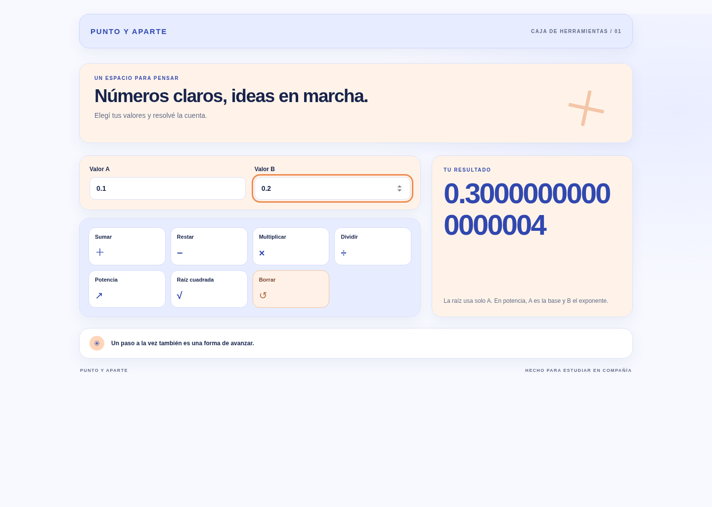
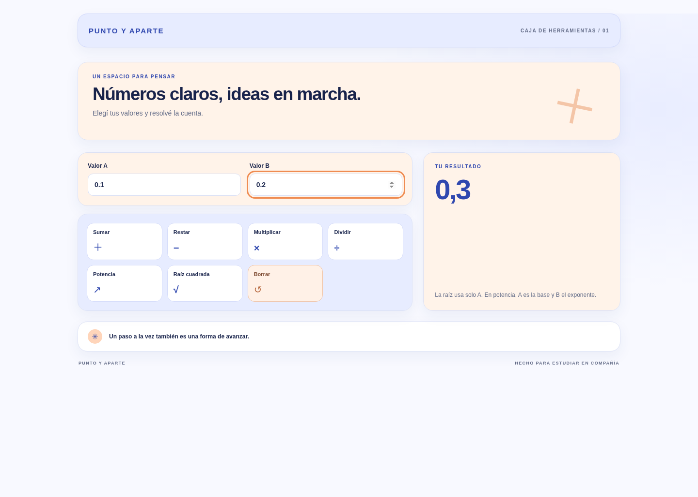
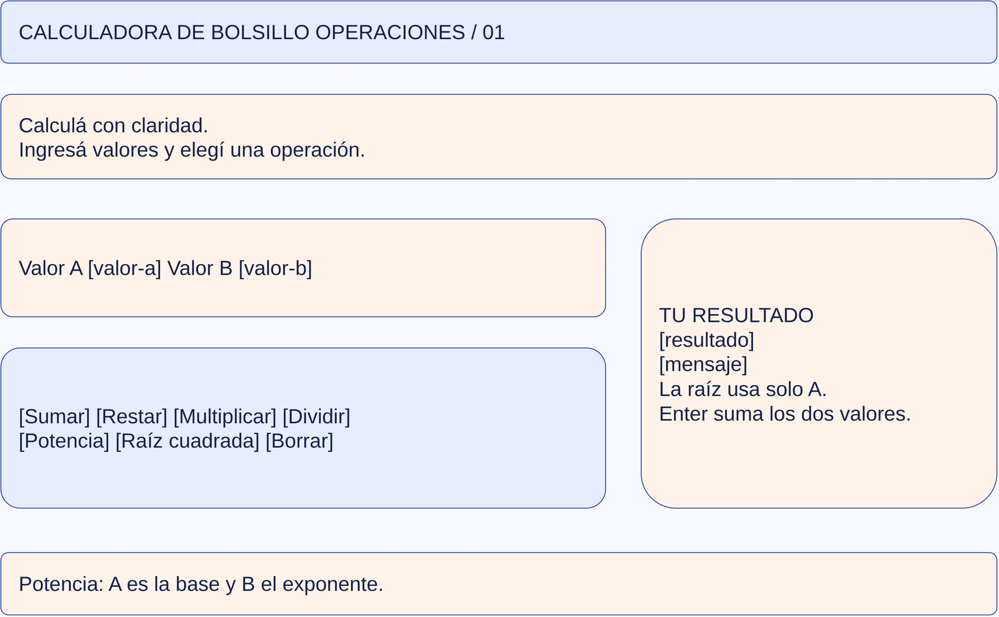
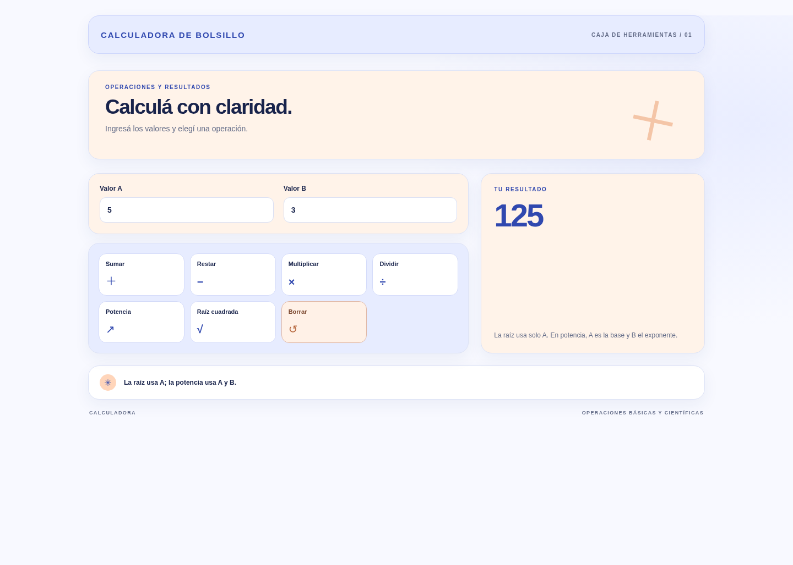

# Calculadora de bolsillo

## 🧩 Datos generales

| Campo | Detalle |
| --- | --- |
| Integrante 1 | Micaela Joaquin |
| Integrante 2 | No corresponde: trabajo individual |
| Modelos de IA utilizados | ChatGPT; GPT-6 Luna (asistencia de implementación y revisión) |
| Tecnologías del proyecto | HTML5, CSS3, JavaScript, Markdown, GitHub |
| Link del repositorio | [Calculadora de bolsillo](https://github.com/2023micaelajoaquin-droid/calculadora-cientifica) |

## Uso

Calculadora independiente para sumar, restar, multiplicar, dividir, elevar el primer valor al segundo y obtener la raíz cuadrada del primer valor. La raíz no requiere el segundo valor. Incluye validaciones de entradas y resultados, y conserva la interacción y presentación propias de esta aplicación.

## Encargos

Registro original del desarrollo; los prompts se conservan tal como se utilizaron.

### Iteración 1

> Implementá una calculadora para Club Punto y Aparte con dos campos valor-a y valor-b, suma, resta, multiplicación, división y botón Borrar. Respetá el boceto: encabezado horizontal, campos y operaciones a la izquierda y panel de resultado a la derecha. Usá azul cobalto #3048af, durazno #ffd5ba, fondo #f8f9ff, títulos sans serif y tarjetas redondeadas. Separá index.html, style.css y script.js. Validá vacíos, números no finitos y división por cero. Resultado en resultado y errores en mensaje. Incluí botones científicos visibles pero deshabilitados en esta primera versión. Diseño adaptable y navegación por teclado, sin frameworks.

### Iteración 2

> Agregá potencia y raíz cuadrada. Potencia usa A como base y B como exponente; raíz solo necesita A. Rechazá raíces negativas y resultados fuera del rango numérico. Conservá las operaciones básicas y el diseño del boceto.

### Iteración 3

> Completá el uso por teclado: Enter desde cualquiera de los campos suma sin recargar; Borrar limpia los valores, el resultado y el error, y devuelve el foco al primer campo. Revisá que los avisos se anuncien y que el resultado largo no desborde en celular.

## Registro de iteración

En Chrome, sumar 0.1 y 0.2 mostraba `0.30000000000000004`. La operación estaba afectada por la representación binaria de decimales y el resultado se presentaba sin formato.

### Prompt 4 — presentación de decimales

> La suma de 0.1 y 0.2 muestra 0.30000000000000004. Presentá los resultados con formato español y hasta 12 cifras significativas, conservando el cálculo interno. No redondees los valores muy pequeños a cero. Revisá además los mensajes de campos vacíos: la raíz solo debe pedir el primer valor y los espacios no deben interpretarse como cero.

**Resultado mejorado:** la misma suma ahora muestra `0,3`. El formato conserva hasta 12 cifras significativas y también representa valores pequeños sin convertirlos en cero. Se comprobaron las cuatro operaciones básicas, potencia y raíz; además de división por cero, raíz negativa, campos vacíos, Enter y Borrar.

## Estado

Cambios realizados localmente. La publicación queda pendiente de decisión del usuario.

## Enlaces

- [Repositorio](https://github.com/2023micaelajoaquin-droid/calculadora-cientifica)
- [Registro anterior en GitHub](https://github.com/2023micaelajoaquin-droid/calculadora-cientifica/blob/e6a27f95e88fc3c9127752d2a8f77ec319e2a7c2/README.md)

## Capturas actuales

Boceto de la interfaz:

Aplicación funcionando con datos de ejemplo:

[Ver captura móvil](evidencias/aplicacion-movil.png).

Estas capturas corresponden a la versión local. El repositorio y el sitio publicados todavía conservan la versión anterior.
